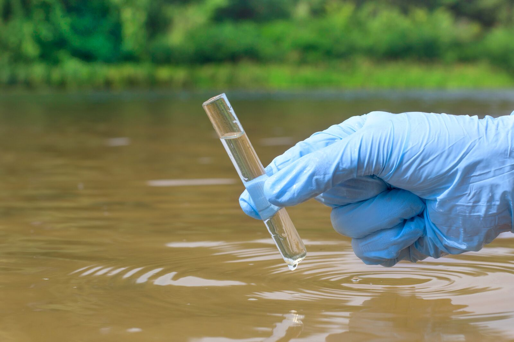

## Problem Description

If you read the news, you may have seen a news article at some point in the last few years with a headline along the lines of **"The water source this small town relies found to be *contaminated*"**. A lot of the time it's not entirely clear what exactly the contaminant was; the only thing that's clear is that someone has done something wrong, and now there's a bunch of people with brown water coming out of their taps at home.

One major thing that can go wrong for a freshwater system (like a river or lake), is an overabundance of **nitrate** in the water. Nitrate is a molecule made up of a nitrogen atom and 3 oxygen atoms, and [fertilizers containing nitrate are widely used in agriculture all over the globe](https://www.sciencedirect.com/topics/agricultural-and-biological-sciences/nitrate-fertiliser). Most plants need a healthy amount of nitrogen to survive and thrive, and nitrate fertilizers contain that nitrogen in a way that is easily accessible to plants.

However, the same thing that makes nitrate perfectly suited to growing crops is also a large part of what causes it to become a problem when it's present in excess in freshwater systems. An overabundance of nitrate can lead to [*eutrophication* happening in a river or lake](https://www.usgs.gov/mission-areas/water-resources/science/nutrients-and-eutrophication). Algae that feed on nitrogen grow too quickly and too much, creating a green layer over the surface of the water. Often the algae will then die in large quantities, leading to additional problems as the bacteria consuming the algae *also* consume all the oxygen in the water; any fish who were present will usually die off at this stage, while other plants below the waters surface will have lost their sunlight a while a go and likely also die off. 

The takeaway here is that monitoring nitrate concentration in freshwater bodies is essential, especially as [farmers around the world continue to increase their usage of nitrate fertilizers every year](https://civileats.com/2024/05/01/across-farm-country-fertilizer-pollution-impacts-not-just-health-but-water-costs-too/). 

There's a problem though. Measuring nitrate concentration in water is costly and time consuming. We're talking about a compound that we would ideally have near real-time monitoring for in freshwater systems that might be at risk, and no-one has the funds or man-power to commit to that level of sensitivity. 

While measuring nitrate concentration might be too expensive, there are a lot of other water quality variables that can be measured more quickly and easily. Variables like:

- Time of day
- Date
- Water temperature
- How high the body of water we're interested in is above sea level
- The electrical conductance of the water
- How turbid (cloudy) the water is
- How much oxygen is dissolved in the water.

And so, enter Kermorvant et al. in 2023! Using the easily measured variables above, they were able to use statistical modelling to predict nitrate concentration in 3 bodies of water *very* accurately, potentially paving the way for future cheap and effective monitoring of nitrate concentration in bodies of water around the world.

## 