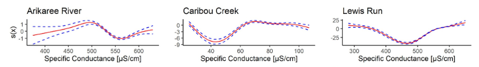

### Link to original paper: 

["Understanding links between water-quality variables and nitrate concentration in freshwater streams using high frequency sensor data" by Kermorvant et al., 2023](https://cwd.numbat.space/assignments/assignment-2-papers/Kermorvant2023.pdf)

Links to related papers can be found in @tbl-additional-reading at the end of the document if you want to read more!

## Problem Description

If you read the news, you may have seen a news article at some point in the last few years with a headline along the lines of **"The water source this small town relies found to be *contaminated*"**. A lot of the time it's not entirely clear what exactly the contaminant was; the only thing that's clear is that someone has done something wrong, and now there's a bunch of people with brown water coming out of their taps at home.

One major thing that can go wrong for a freshwater system (like a river or lake), is an overabundance of **nitrate** in the water. Nitrate is a molecule made up of a nitrogen atom and 3 oxygen atoms, and [fertilizers containing nitrate are widely used in agriculture all over the globe](https://www.sciencedirect.com/topics/agricultural-and-biological-sciences/nitrate-fertiliser). Most plants need a healthy amount of nitrogen to survive and thrive, and nitrate fertilizers contain that nitrogen in a way that is easily accessible to plants.

However, the same thing that makes nitrate perfectly suited to growing crops is also a large part of what causes it to become a problem when it's present in excess in freshwater systems. An overabundance of nitrate can lead to [*eutrophication* happening in a river or lake](https://www.usgs.gov/mission-areas/water-resources/science/nutrients-and-eutrophication). Algae that feed on nitrogen grow too quickly and too much, creating a green layer over the surface of the water. Often the algae will then die in large quantities, leading to additional problems as the bacteria consuming the algae *also* consume all the oxygen in the water; any fish who were present will usually die off at this stage, while other plants below the waters surface will have lost their sunlight a while a go and likely also die off. 

The takeaway here is that monitoring nitrate concentration in freshwater bodies is essential, especially as [farmers around the world continue to increase their usage of nitrate fertilizers every year](https://civileats.com/2024/05/01/across-farm-country-fertilizer-pollution-impacts-not-just-health-but-water-costs-too/). 

There's a problem though. Measuring nitrate concentration in water is costly and time consuming. We're talking about a compound that we would ideally have near real-time monitoring for in freshwater systems that might be at risk, and no-one has the funds or man-power to commit to that level of sensitivity. 

While measuring nitrate concentration might be too expensive, there are a lot of other water quality variables that can be measured more quickly and easily. Variables like:

- Time of day
- Date
- Water temperature
- How high the body of water we're interested in is above sea level
- The electrical conductance of the water
- How turbid (cloudy) the water is
- How much oxygen is dissolved in the water.


And so, enter Kermorvant et al. in 2023! Using the easily measured variables above, they were able to use statistical modelling to predict nitrate concentration in 3 bodies of water *very* accurately, potentially paving the way for future cheap and effective monitoring of nitrate concentration in bodies of water around the world.

One of the major problems with this kind of predictive modelling for water quality variables is that water systems are *incredibly* complex. This results in relationships between two identical variables being completely different at different sites. Keep this in mind; we'll return to it in the conclusion.


## Analysis

In this paper, Kermorvant et al. used open-source data from the National Ecological Observatory Network (NEON). NEON provides data from sites across the United States of America, and all their sites are equipped with permanent on-site sensors that provide high-frequency, standardised measurements. They picked three sites that were very different from each other in terms of location and climate to prove their methods could work anywhere; the Arikaree River in Colorado, Caribou-Poker Creeks Research Watershed in Alaska, and Lewis Run in Virginia. 

Once they had their sites selected and had collected the variables we talked about above, the authors used a two-step modelling approach to analyse their data. In laymans terms; they performed a statistical process on the data, then did more statistics on the results of that first process. At some of the sites they tested, just doing the first step would have allowed them to predict the nitrate concentration in the water there with a very high degree of accuracy. At other sites however, the second step accounted for up to 25% of the predictive power of their approach.

As discussed earlier, one of the major issues with this type of predictive analysis for water quality variables is the changing relationships between variables across different freshwater systems. The plots below (@fig-nitrate-time) show the relationship between nitrate concentration and the conductivity of water at each of the three sites. Don't worry about fully understanding them; the main takeaway here should be that each of them has a different shape. This means that knowing what the conductivity of the water is at a new site and knowing how much nitrate was in the water at that conductivity at an old site isn't enough. In order to be able to predict the nitrate concentration in the water at a new site, we need measurements of all the variables we've already talked about *and* we need to set up new models for the new site. In order to set up those new models, this method does require that we spend some time measuring nitrate concentration alongside those other variables, so that the relationships between water quality variables at the new site can be properly established. 

Keep that in the same corner of your mind as the first piece of information we're storing for the conclusion!

{#fig-nitrate-time}

There's a key question we should answer before we wrap things up here though: just how effective are the techniques described by Claire Kermorvant and her co-authors? In a word: **very**. The models they created were able to account for an astonishing **99% of the variation in nitrate concentration in the water at all three of their sites**. It is worth reiterating that these three sites are spread across North America, in Colorado, Alaska and Virginia. They are all part of very different ecosystems, and experience very different conditions throughout the year. Despite that, Kermorvant and (hopefully) friends have managed to show that they have a method that is almost as effective as real-time monitoring for nitrate concentration at each of the three sites.

## Conclusion

So that's it then, right? This method is basically as good as those expensive and time-consuming direct nitrate sampling methods we want to replace, and it's much cheaper and easier, so we can just deploy it immediately to every water system in the world we might think is at risk of nitrate poisoning and call it a job well done?

Not quite.

Remember, I've asked you to hold onto two key pieces of information:

1. The relationship between two water quality variables will be different at different sites.
2. This method *requires* that we spend some time measuring nitrate concentration in order to establish functioning predictive models for a new site.

The second point is a direct consequence of the first, and the overall result here is that this is not a silver bullet solution to all the issues we have with monitoring nitrate concentration in waterways. It's not necessarily clear from the original paper how long you'd need to spend measuring nitrate concentration at a new site in order to have a strong ability to predict nitrate concentration there (probably because that would vary from site to site) but it's a safe bet that the answer is at minimum several months. That's a potentially prohibitive upfront cost for a lot of organisations who monitor water quality, who in many places in the last few years [have seen themselves targeted foir budget cuts and layoffs already](https://environmentvictoria.org.au/2025/12/04/victorias-gutting-of-environment-agencies-poses-grave-threats-to-nature/).

What this paper does show is that while the relationships between different indicators of water quality in freshwater systems are complex, they're not impenetrable. There are patterns to be found, and modern modelling techniques are able to make sense of those patterns. In the words of the original authors there's hope that work like this, "provides a basis for future studies focused on the prediction of other critically important, water-quality variables that cannot be measured using in-situ sensors or when the sensors themselves are cost prohibitive". As always science is collaborative, and this may prove to be an important foundation in allowing for accurate prediction of water quality at sites where testing is not feasible in future.

## Additional Reading (this is *definitely* not my references from part 1 repurposed into a table to meet the rubric)

```{r}
#| label: tbl-additional-reading
#| echo: false
#| warning: false
#| message: false

library(tibble)
library(dplyr)
library(knitr)
library(kableExtra)

references <- tibble(
  Authors = c(
    "Hart, J. K., & Martinez, K.",
    "Hill, D. J., & Minsker, B. S.",
    "Boesch, D. F., Boynton, W. R., Crowder, L. B., Diaz, R. J., Howarth, R. W., Mee, L. D., et al.",
    "Bricker, S. B., Longstaff, B., Dennison, W., Jones, A., Boicourt, K., Wicks, C., et al.",
    "Wang, Z. H., & Li, S. X."
  ),
  Year = c(2006, 2010, 2009, 2008, 2019),
  Title = c(
    "Environmental Sensor Networks: A Revolution in the Earth System Science?",
    "Anomaly Detection in Streaming Environmental Sensor Data: A Data-Driven Modeling Approach",
    "Nutrient Enrichment Drives Gulf of Mexico Hypoxia",
    "Effects of Nutrient Enrichment in the Nation's Estuaries: A Decade of Change",
    "Nitrate N Loss by Leaching and Surface Runoff in Agricultural Land: A Global Issue (A Review)"
  ),
  Publication = c(
    "Earth-Science Reviews, 78(3), 177–191",
    "Environmental Modelling & Software, 25(9), 1014–1022",
    "Eos, Transactions American Geophysical Union, 90(14), 117–118",
    "Harmful Algae, 8(1), 21–32",
    "Advances in Agronomy, 156(1), 159–217"
  ),
  DOI = c(
    "https://doi.org/10.1016/j.earscirev.2006.05.001",
    "https://doi.org/10.1016/j.envsoft.2009.08.010",
    "https://doi.org/10.1029/2009EO140001",
    "https://doi.org/10.1016/j.hal.2008.08.028",
    "https://doi.org/10.1016/bs.agron.2019.01.007"
  )
)

references |>
  arrange(Title) |>
  mutate(
    Title = cell_spec(
      Title,
      format = "html",
      link = DOI
    )
  ) |>
  select(
    `Paper name` = Title,
    Year,
    Authors
  ) |>
  kable(
    format = "html",
    escape = FALSE,
    align = c("l", "c", "l")
  ) |>
  kable_styling(
    bootstrap_options = c("striped", "hover"),
    full_width = TRUE
  )
```